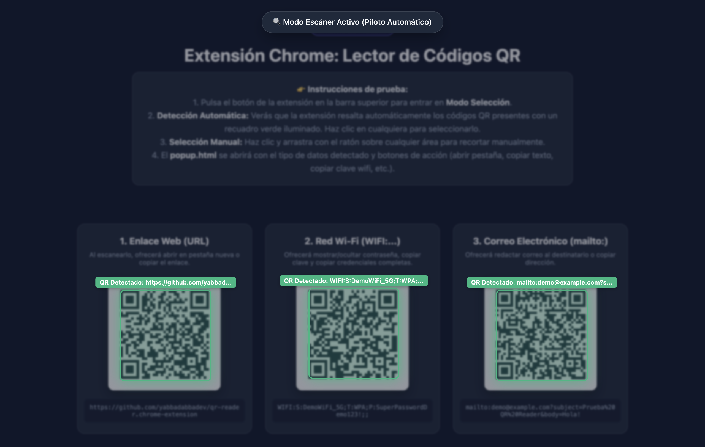

# QR Code Reader & Scanner (Chrome Extension)

[🇪🇸 Español](README.md) • [🇬🇧 English](README.en.md)


A modern Google Chrome extension built on **Manifest V3** to scan and decode any visible QR code directly on your screen. Features instant auto-detection, precision manual crop selection, and smart contextual actions.



---

## ✨ Key Features

1. **1-Click Activation:** Click the extension icon in your browser toolbar to instantly freeze the active tab into scanner mode.
2. **Automatic Detection:** Automatically discovers all visible QR codes on the screen using native `BarcodeDetector` with a local `jsQR` fallback engine, highlighting them with interactive clickable borders.
3. **Precision Marquee Crop:** Click and drag your cursor over any portion of the screen to decode any QR code, regardless of size or background contrast.
4. **Smart Contextual Popup:** Decoding a QR code opens a clean popup with tailor-made actions based on the detected content:
   - 🔗 **Web URLs:** Open in a new tab or copy link to clipboard.
   - 📶 **Wi-Fi Networks:** Display SSID, toggle password visibility with a reveal eye button, or copy credentials directly.
   - ✉️ **Email (`mailto:`):** Compose email in your default email client or copy email address.
   - 📞 **Phone (`tel:`):** Place call or copy phone number.
   - 📝 **Plain Text:** Preview formatted text and copy with visual confirmation.
5. **Quick Rescan:** *"Scan another QR"* button inside the popup allows you to chain multiple scans seamlessly.
6. **Universal Compatibility:** Works over images, websites, streaming video frames (YouTube, Vimeo, etc.), canvas graphics, and PDF documents.
7. **100% Private & Offline:** Entire image processing and decoding happens on-device. Zero telemetry, zero analytics, zero external network requests.

---

## 🛠️ How to Install in Google Chrome

Installing the extension takes less than a minute. No build tools or Node.js required.

### Step 1: Download the Project

Choose your preferred method:

- **Option A (Easiest — No terminal needed):**
  1. Click the green **`Code`** button at the top right of this repository.
  2. Click **`Download ZIP`**.
  3. Extract the downloaded `.zip` file into a folder of your choice (e.g., your *Documents* or *Downloads* folder).

- **Option B (For developers using Git):**
  ```bash
  git clone https://github.com/yabbadabbadev/qr-reader.chrome-extension.git
  ```

---

### Step 2: Load the Extension into Chrome

1. Open Google Chrome and navigate to:
   ```text
   chrome://extensions
   ```
2. In the top-right corner, toggle on **"Developer mode"**.
3. In the top-left corner, click the **"Load unpacked"** button.
4. Select the unzipped folder containing `manifest.json`.
5. Done! The extension is now loaded and ready to use.

---

### Step 3: Pin the Extension to the Toolbar (Recommended)

1. Click the **Puzzle icon** (Extensions) in Chrome's top-right toolbar.
2. Find **QR Code Reader & Scanner** and click the **Pin icon** 📌.
3. You can now trigger the scanner anytime with a single click.

---

## 🔄 How to Update

When an update is released:
- If you used Git: run `git pull` inside the folder.
- If you downloaded a ZIP: replace the folder contents with the new ZIP files.
- Go to `chrome://extensions` and click the **Reload 🔄** icon on the extension's card.

---

## 📄 Scanning Local PDF Files

By default, Chrome disables extension access to local `file://` URLs for security reasons. To scan local PDFs opened in Chrome:
1. Navigate to `chrome://extensions`.
2. Find **QR Code Reader & Scanner** and click **"Details"**.
3. Enable the **"Allow access to file URLs"** toggle.

---

## 🧪 Testing the Extension

### Option A: Test with the included sample page
Open the test page by pasting its local path into Chrome's address bar:
```text
file:///path/to/qr-reader.chrome-extension/test/index.html
```
You will find 6 real QR code test cases (URL, Wi-Fi, Email, Phone, Plain text, and an animated video simulation frame).

### Option B: Run Autonomous E2E Tests
If you have Node.js installed and want to run the automated Chrome CDP test suite:
```bash
npm install
node test/autonomous-verify.js
```
This launches a headless/windowed Chrome instance, executes both auto-detection and manual crop scans, and captures proof screenshots into `test/screenshots/`.

---

## 📁 Repository Structure

```text
qr-reader.chrome-extension/
├── manifest.json              # Manifest V3 extension configuration
├── background.js              # Service Worker (tab capture, storage & popup trigger)
├── content/
│   ├── overlay.js             # Content script with Shadow DOM and auto/manual crop detection
│   └── overlay.css            # Scoped styles for the overlay
├── popup/
│   ├── popup.html             # Popup user interface
│   ├── popup.js               # Context-aware action controller
│   └── popup.css              # Responsive styles with dark mode support
├── lib/
│   ├── jsqr.js                # Self-contained QR decoder engine (no network calls)
│   └── qr-parser.js           # Content type classifier and payload parser
├── icons/                     # Real PNG extension icons (16x16, 48x48, 128x128)
├── test/
│   ├── index.html             # Visual test showcase with 6 QR types
│   ├── autonomous-verify.js   # Autonomous verification runner via Chrome CDP
│   └── screenshots/           # Verification proof screenshots
├── docs/                      # Architectural specs and implementation logs
└── LICENSE                    # MIT License
```

---

## 🔒 Privacy & Security

- **100% Local:** All image processing and barcode decoding is executed strictly on the client side.
- **Zero Network Traffic:** The extension never sends tabs, images, or decoded data to external servers.
- **Minimal Permissions:** Only requests permissions strictly required for screen capture and UI injection (`activeTab`, `storage`, `scripting`) when the user clicks the toolbar icon.

---

## 📜 License

Distributed under the MIT License. See [LICENSE](LICENSE) for more details.
