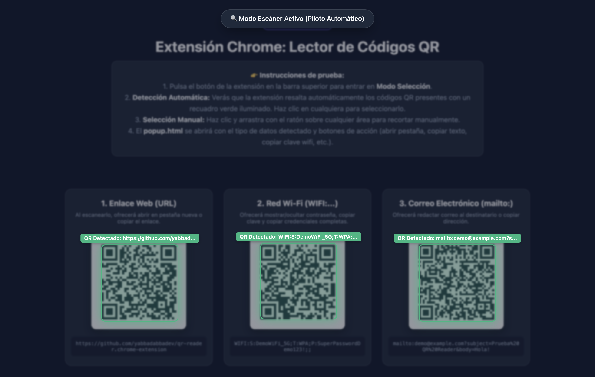

# QR Code Reader & Scanner (Chrome Extension)

[🇪🇸 Español](README.md) • [🇬🇧 English](README.en.md)


Extensión moderna de Google Chrome construida con **Manifest V3** para escanear y decodificar códigos QR visibles en la pantalla de tu navegador, con detección automática instantánea, recorte manual de precisión y acciones contextuales inteligentes.



---

## ✨ Características Principales

1. **Activación con 1 Clic:** Al pulsar el icono en la barra de herramientas, se activa el modo de selección en la pestaña activa.
2. **Detección Automática:** Localiza todos los códigos QR presentes en pantalla mediante `BarcodeDetector` nativo y `jsQR` como motor local, resaltándolos con un marco interactivo clicable.
3. **Selección Manual (Marquee Crop):** Permite pulsar y arrastrar el cursor para recortar con precisión cualquier QR, por pequeño o complejo que sea.
4. **Popup con Acciones Inteligentes:** Al seleccionar un código, se abre automáticamente la ventana de la extensión ofreciendo acciones según el tipo de contenido:
   - 🔗 **Enlaces Web (URLs):** Abrir en pestaña nueva y copiar enlace al portapapeles.
   - 📶 **Redes Wi-Fi:** Visualizar SSID, mostrar/ocultar contraseña con botón de ojo y copiar clave o datos completos.
   - ✉️ **Correo Electrónico (`mailto:`):** Redactar correo directamente en el cliente predeterminado o copiar dirección.
   - 📞 **Teléfono (`tel:`):** Llamar o copiar número.
   - 📝 **Texto Plano:** Previsualizar texto y copiar con confirmación visual.
5. **Reescaneo Rápido:** Botón *"Escanear otro QR"* en el popup para encadenar lecturas sin pasos intermedios.
6. **Soporte Universal:** Funciona sobre imágenes, páginas web, vídeos (YouTube, Vimeo, etc.), canvas, fondos CSS y documentos PDF.
7. **Privacidad Total:** Procesamiento 100% en local en tu dispositivo, sin envío de datos a servidores externos ni analíticas.

---

## 🛠️ Cómo Instalar la Extensión en Google Chrome

Instalarla toma menos de 1 minuto y no requiere instalar Node.js ni compilar código. Sigue estos pasos:

### Paso 1: Descargar el proyecto

Elige la opción que prefieras:

- **Opción A (Fácil, sin terminal):**
  1. Haz clic en el botón verde **`Code`** arriba a la derecha en este repositorio.
  2. Selecciona **`Download ZIP`**.
  3. Descomprime el archivo `.zip` descargado en cualquier carpeta de tu ordenador (por ejemplo, en tu carpeta de *Documentos* o *Descargas*).

- **Opción B (Para desarrolladores con Git):**
  ```bash
  git clone https://github.com/yabbadabbadev/qr-reader.chrome-extension.git
  ```

---

### Paso 2: Cargar la extensión en Chrome

1. Abre Google Chrome y escribe en la barra de direcciones:
   ```text
   chrome://extensions
   ```
2. En la esquina superior derecha, activa el interruptor **"Modo de desarrollador"** (*Developer mode*).
3. Haz clic en el botón **"Cargar descomprimida"** (*Load unpacked*) que aparecerá en la esquina superior izquierda.
4. Selecciona la carpeta donde descargaste o clonaste la extensión (la carpeta que contiene el archivo `manifest.json`).
5. ¡Listo! La extensión ya estará activa en tu navegador.

---

### Paso 3: Fijar el icono en la barra de herramientas (Recomendado)

Para tenerla siempre a mano:
1. Haz clic en el icono del **puzle** (Extensiones) situado arriba a la derecha en Chrome.
2. Busca **QR Code Reader & Scanner** y haz clic en el icono de la **chincheta (pin)**.
3. Ahora podrás escanear cualquier QR con un solo clic.

---

## 🔄 Cómo Actualizar la Extensión en el Futuro

Si descargas una versión más reciente:
- Si usas Git: ejecuta `git pull` en la carpeta.
- Si usaste el ZIP: reemplaza los archivos de la carpeta con el nuevo ZIP descomprimido.
- Luego entra en `chrome://extensions` y pulsa en el icono de **recarga 🔄** de la tarjeta de la extensión.

---

## 📄 ¿Quieres escanear documentos PDF locales?

Por seguridad de Chrome, las extensiones tienen deshabilitado por defecto el acceso a archivos locales (`file://`). Si deseas escanear un PDF abierto desde tu disco duro:
1. En `chrome://extensions`, busca **QR Code Reader & Scanner**.
2. Haz clic en **"Detalles"**.
3. Activa la casilla **"Permitir acceso a URLs de archivo"** (*Allow access to file URLs*).

---

## 🧪 Cómo Probar la Extensión

### Opción A: Probar con la página de demostración
Abre el archivo de prueba incluido abriendo la siguiente dirección en tu navegador (sustituyendo por tu ruta local):
```text
file:///ruta/a/qr-reader.chrome-extension/test/index.html
```
Encontrarás 6 muestras de códigos QR reales (URL, Wi-Fi, Email, Teléfono, Texto plano y un fotograma con degradado dinámico).

### Opción B: Ejecutar la Verificación Autónoma (Tests E2E)
Si tienes Node.js instalado y quieres ejecutar la suite automatizada con Chrome CDP:
```bash
npm install
node test/autonomous-verify.js
```
El script lanzará una instancia aislada de Google Chrome, probará el flujo completo de detección y guardará capturas de pantalla de verificación en `test/screenshots/`.

---

## 📁 Estructura del Proyecto

```text
qr-reader.chrome-extension/
├── manifest.json              # Configuración Manifest V3
├── background.js              # Service Worker (captura visible, almacenamiento y apertura de popup)
├── content/
│   ├── overlay.js             # Content script con Shadow DOM y detección automática/recorte
│   └── overlay.css            # Estilos aislados del overlay
├── popup/
│   ├── popup.html             # Interfaz del popup
│   ├── popup.js               # Controlador de acciones inteligentes
│   └── popup.css              # Estilos responsivos con soporte para modo oscuro
├── lib/
│   ├── jsqr.js                # Motor de decodificación QR sin dependencias de red
│   └── qr-parser.js           # Parser clasificador de tipos de contenido QR
├── icons/                     # Iconos oficiales (16x16, 48x48, 128x128)
├── test/
│   ├── index.html             # Página de prueba con códigos QR reales
│   ├── autonomous-verify.js   # Script de pruebas autónomas con Chrome CDP
│   └── screenshots/           # Capturas de evidencia generadas durante las pruebas
├── docs/                      # Especificación técnica y arquitectura
└── LICENSE                    # Licencia MIT
```

---

## 🔒 Privacidad y Seguridad

- **100% Local:** El análisis de las imágenes y la decodificación de los códigos QR ocurre íntegramente dentro de tu navegador.
- **Sin conexiones de red:** No se envían imágenes, URLs ni datos a ningún servidor externo.
- **Permisos mínimos:** Solo solicita los permisos estrictamente necesarios (`activeTab`, `storage`, `scripting`) para capturar la pantalla y mostrar la interfaz de recorte cuando el usuario hace clic.

---

## 📜 Licencia

Distribuido bajo la Licencia MIT. Consulta el archivo [LICENSE](LICENSE) para más detalles.
