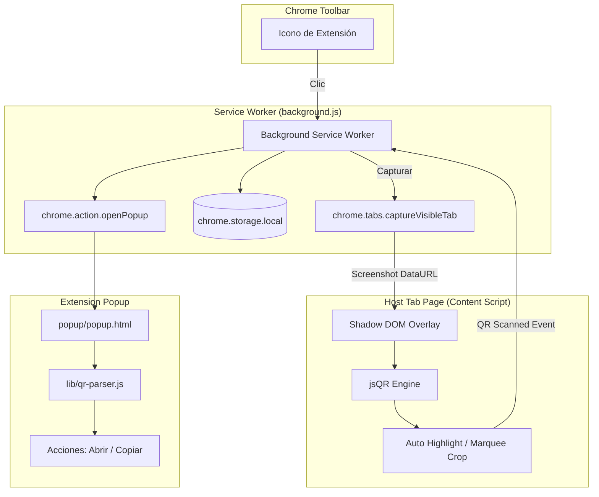

# QR Code Reader Chrome Extension Implementation Plan

> **For agentic workers:** REQUIRED SUB-SKILL: Use superpowers:subagent-driven-development to implement this plan task-by-task. Steps use checkbox (`- [ ]`) syntax for tracking.

**Goal:** Construir y verificar una extensión de Chrome (Manifest V3) que active el modo selección en pantalla al pulsar su icono, detecte códigos QR de forma automática y por recorte manual, y abra automáticamente el popup con acciones específicas según el tipo de contenido (URL, Texto, Wi-Fi, Email, Teléfono).

**Architecture:** La extensión utiliza un Service Worker (`background.js`) que escucha `chrome.action.onClicked`, captura la pestaña visible con `chrome.tabs.captureVisibleTab` e inyecta un Content Script con Shadow DOM (`content/overlay.js`). El overlay ejecuta el motor `jsQR` para resaltar automáticamente los QR visibles o procesar el área recortada por el usuario. Al detectar un código, se almacena en `chrome.storage.local`, se asigna el popup activo y se abre mediante `chrome.action.openPopup()`, permitiendo interactuar con los datos procesados por `lib/qr-parser.js`.

**Architecture Diagram:**



**Tech Stack:** JavaScript (ES2022, Vanilla, Manifest V3), Canvas API, `jsQR` (standalone), Web Clipboard API, Chrome Extensions API (`chrome.action`, `chrome.tabs`, `chrome.storage`, `chrome.scripting`), Node.js (scripts de iconos y pruebas).

---

### Task 1: Generación de Iconos y Estructura Base

**Files:**
- Create: `scripts/generate-icons.js`
- Create: `icons/icon-16.png`
- Create: `icons/icon-48.png`
- Create: `icons/icon-128.png`
- Create: `.gitignore`

- [ ] **Step 1: Crear script de generación de iconos PNG con Node.js y zlib**
Escribir `scripts/generate-icons.js` que dibuje un icono nítido de código QR con esquinas de visor/escáner en formato PNG binario válido para 16x16, 48x48 y 128x128 píxeles.

```javascript
// scripts/generate-icons.js
const fs = require('fs');
const path = require('path');
const zlib = require('zlib');

function createPNG(size) {
  // Genera un PNG RGBA sin dependencias externas usando chunks IHDR, IDAT, IEND
  const width = size;
  const height = size;
  const buffer = Buffer.alloc((width * 4 + 1) * height);

  const primary = [79, 70, 229, 255]; // Indigo #4f46e5
  const accent = [16, 185, 129, 255]; // Emerald #10b981
  const bg = [255, 255, 255, 255];

  for (let y = 0; y < height; y++) {
    const rowOffset = y * (width * 4 + 1);
    buffer[rowOffset] = 0; // Filter type: None
    for (let x = 0; x < width; x++) {
      const pxOffset = rowOffset + 1 + x * 4;
      // Dibuja esquinas de visor escáner y patrón central de QR
      const isCornerBorder =
        ((x <= Math.floor(size * 0.3) || x >= Math.floor(size * 0.7)) && (y === 1 || y === 2 || y === height - 2 || y === height - 3)) ||
        ((y <= Math.floor(size * 0.3) || y >= Math.floor(size * 0.7)) && (x === 1 || x === 2 || x === width - 2 || x === width - 3));
      
      const isQRModule =
        (x >= Math.floor(size * 0.35) && x <= Math.floor(size * 0.65) && y >= Math.floor(size * 0.35) && y <= Math.floor(size * 0.65)) ||
        (x % 3 === 0 && y % 3 === 0 && x > 2 && x < width - 3 && y > 2 && y < height - 3);

      if (isCornerBorder) {
        buffer[pxOffset] = accent[0];
        buffer[pxOffset + 1] = accent[1];
        buffer[pxOffset + 2] = accent[2];
        buffer[pxOffset + 3] = accent[3];
      } else if (isQRModule) {
        buffer[pxOffset] = primary[0];
        buffer[pxOffset + 1] = primary[1];
        buffer[pxOffset + 2] = primary[2];
        buffer[pxOffset + 3] = primary[3];
      } else {
        buffer[pxOffset] = bg[0];
        buffer[pxOffset + 1] = bg[1];
        buffer[pxOffset + 2] = bg[2];
        buffer[pxOffset + 3] = 240;
      }
    }
  }

  function crc32(buf) {
    let c;
    const table = [];
    for (let n = 0; n < 256; n++) {
      c = n;
      for (let k = 0; k < 8; k++) c = c & 1 ? 0xedb88320 ^ (c >>> 1) : c >>> 1;
      table[n] = c;
    }
    let crc = 0 ^ -1;
    for (let i = 0; i < buf.length; i++) crc = (crc >>> 8) ^ table[(crc ^ buf[i]) & 0xff];
    return (crc ^ -1) >>> 0;
  }

  function makeChunk(type, data) {
    const len = Buffer.alloc(4);
    len.writeUInt32BE(data.length, 0);
    const typeBuf = Buffer.from(type, 'ascii');
    const crcBuf = Buffer.alloc(4);
    crcBuf.writeUInt32BE(crc32(Buffer.concat([typeBuf, data])), 0);
    return Buffer.concat([len, typeBuf, data, crcBuf]);
  }

  const signature = Buffer.from([137, 80, 78, 71, 13, 10, 26, 10]);
  const ihdr = Buffer.alloc(13);
  ihdr.writeUInt32BE(width, 0);
  ihdr.writeUInt32BE(height, 4);
  ihdr[8] = 8; // Bit depth
  ihdr[9] = 6; // Color type RGBA
  ihdr[10] = 0;
  ihdr[11] = 0;
  ihdr[12] = 0;

  const idat = zlib.deflateSync(buffer);
  return Buffer.concat([
    signature,
    makeChunk('IHDR', ihdr),
    makeChunk('IDAT', idat),
    makeChunk('IEND', Buffer.alloc(0))
  ]);
}

const iconsDir = path.join(__dirname, '..', 'icons');
if (!fs.existsSync(iconsDir)) fs.mkdirSync(iconsDir, { recursive: true });

[16, 48, 128].forEach(size => {
  const filePath = path.join(iconsDir, `icon-${size}.png`);
  fs.writeFileSync(filePath, createPNG(size));
  console.log(`Generated: ${filePath}`);
});
```

- [ ] **Step 2: Ejecutar la generación de iconos y verificar dimensiones**

Run: `node scripts/generate-icons.js && sips -g pixelWidth -g pixelHeight icons/icon-16.png icons/icon-48.png icons/icon-128.png`
Expected: Dimensiones 16x16, 48x48 y 128x128 respectivamente.

- [ ] **Step 3: Crear `.gitignore`**

```gitignore
node_modules/
.DS_Store
*.log
```

- [ ] **Step 4: Commit**

```bash
git add scripts/generate-icons.js icons/ .gitignore
git commit -m "feat: generate extension icons and configure gitignore"
```

---

### Task 2: Motor de Decodificación y Parser de Formatos QR

**Files:**
- Create: `lib/jsqr.js`
- Create: `lib/qr-parser.js`
- Create: `test/qr-parser.test.js`

- [ ] **Step 1: Escribir test unitario de `lib/qr-parser.js` (TDD)**

```javascript
// test/qr-parser.test.js
const assert = require('assert');
const { parseQRCode } = require('../lib/qr-parser.js');

// Test 1: URL http/https
const urlRes = parseQRCode('https://github.com/yabbadabbadev');
assert.strictEqual(urlRes.type, 'URL');
assert.strictEqual(urlRes.data.url, 'https://github.com/yabbadabbadev');
assert.strictEqual(urlRes.actions.includes('open_url'), true);

// Test 2: Red Wi-Fi
const wifiRes = parseQRCode('WIFI:T:WPA;S:MiFibra-1234;P:SuperSecretPass;;');
assert.strictEqual(wifiRes.type, 'WIFI');
assert.strictEqual(wifiRes.data.ssid, 'MiFibra-1234');
assert.strictEqual(wifiRes.data.password, 'SuperSecretPass');
assert.strictEqual(wifiRes.data.authType, 'WPA');

// Test 3: Email mailto
const emailRes = parseQRCode('mailto:soporte@example.com?subject=Hola');
assert.strictEqual(emailRes.type, 'EMAIL');
assert.strictEqual(emailRes.data.email, 'soporte@example.com');

// Test 4: Teléfono
const telRes = parseQRCode('tel:+34912345678');
assert.strictEqual(telRes.type, 'TEL');
assert.strictEqual(telRes.data.phone, '+34912345678');

// Test 5: Texto general
const textRes = parseQRCode('Mensaje de prueba con texto simple');
assert.strictEqual(textRes.type, 'TEXT');
assert.strictEqual(textRes.data.text, 'Mensaje de prueba con texto simple');

console.log('Todos los tests de parseQRCode pasaron correctamente.');
```

- [ ] **Step 2: Verificar que el test falla antes de la implementación**

Run: `node test/qr-parser.test.js`
Expected: FAIL con `Cannot find module '../lib/qr-parser.js'`.

- [ ] **Step 3: Implementar `lib/qr-parser.js`**

```javascript
// lib/qr-parser.js
(function (root, factory) {
  if (typeof module === 'object' && module.exports) {
    module.exports = factory();
  } else {
    root.QRParser = factory();
  }
})(typeof self !== 'undefined' ? self : this, function () {
  function parseQRCode(rawText) {
    if (!rawText || typeof rawText !== 'string') {
      return { type: 'TEXT', raw: '', data: { text: '' }, actions: ['copy'] };
    }
    const trimmed = rawText.trim();

    // 1. Wi-Fi: WIFI:T:WPA;S:SSID;P:PASSWORD;;
    if (/^WIFI:/i.test(trimmed)) {
      const ssidMatch = trimmed.match(/S:([^;]+)/i);
      const passMatch = trimmed.match(/P:([^;]+)/i);
      const typeMatch = trimmed.match(/T:([^;]+)/i);
      const hiddenMatch = trimmed.match(/H:([^;]+)/i);

      return {
        type: 'WIFI',
        raw: trimmed,
        title: 'Red Wi-Fi',
        data: {
          ssid: ssidMatch ? ssidMatch[1] : '',
          password: passMatch ? passMatch[1] : '',
          authType: typeMatch ? typeMatch[1] : 'WPA',
          hidden: hiddenMatch ? hiddenMatch[1] === 'true' : false
        },
        actions: ['copy_password', 'copy_all']
      };
    }

    // 2. Email: mailto:user@domain.com or MATMSG:
    if (/^mailto:/i.test(trimmed)) {
      const parsedUrl = new URL(trimmed);
      return {
        type: 'EMAIL',
        raw: trimmed,
        title: 'Correo Electrónico',
        data: {
          email: parsedUrl.pathname,
          subject: parsedUrl.searchParams.get('subject') || '',
          body: parsedUrl.searchParams.get('body') || ''
        },
        actions: ['send_email', 'copy_email']
      };
    }

    // 3. Teléfono: tel:+123456789
    if (/^tel:/i.test(trimmed)) {
      const phone = trimmed.replace(/^tel:/i, '');
      return {
        type: 'TEL',
        raw: trimmed,
        title: 'Número de Teléfono',
        data: { phone },
        actions: ['call', 'copy_phone']
      };
    }

    // 4. URL: http://, https://, o ftp://
    if (/^(https?|ftp):\/\/[^\s/$.?#].[^\s]*$/i.test(trimmed)) {
      return {
        type: 'URL',
        raw: trimmed,
        title: 'Enlace Web',
        data: { url: trimmed },
        actions: ['open_url', 'copy_url']
      };
    }

    // 5. Texto Plano por defecto
    return {
      type: 'TEXT',
      raw: trimmed,
      title: 'Texto Plano',
      data: { text: trimmed },
      actions: ['copy_text']
    };
  }

  return { parseQRCode };
});
```

- [ ] **Step 4: Integrar `lib/jsqr.js` empaquetado**
Descargar la librería `jsQR` 1.4.0 (minificada, pura sin dependencias) en `lib/jsqr.js`.

Run: `curl -sL https://cdn.jsdelivr.net/npm/jsqr@1.4.0/dist/jsQR.min.js -o lib/jsqr.js`
Expected: Archivo `lib/jsqr.js` creado con tamaño ~43KB.

- [ ] **Step 5: Ejecutar los tests de `lib/qr-parser.js`**

Run: `node test/qr-parser.test.js`
Expected: `Todos los tests de parseQRCode pasaron correctamente.`

- [ ] **Step 6: Commit**

```bash
git add lib/ test/qr-parser.test.js
git commit -m "feat: add jsQR engine and qr-parser with tests"
```

---

### Task 3: Manifest V3 y Service Worker (`background.js`)

**Files:**
- Create: `manifest.json`
- Create: `background.js`

- [ ] **Step 1: Crear `manifest.json` cumpliendo reglas MV3**

```json
{
  "manifest_version": 3,
  "name": "QR Code Reader & Scanner",
  "version": "1.0.0",
  "description": "Escanea códigos QR en pantalla de forma automática o mediante selección manual.",
  "permissions": [
    "activeTab",
    "storage",
    "scripting"
  ],
  "action": {
    "default_icon": {
      "16": "icons/icon-16.png",
      "48": "icons/icon-48.png",
      "128": "icons/icon-128.png"
    },
    "default_title": "Escanear QR en pantalla"
  },
  "background": {
    "service_worker": "background.js"
  },
  "icons": {
    "16": "icons/icon-16.png",
    "48": "icons/icon-48.png",
    "128": "icons/icon-128.png"
  }
}
```

- [ ] **Step 2: Crear `background.js`**

```javascript
// background.js

// Escucha el clic sobre la acción de la barra de herramientas
chrome.action.onClicked.addListener(async (tab) => {
  if (!tab.id) return;
  await startScanningFlow(tab);
});

async function startScanningFlow(tab) {
  try {
    // 1. Captura la pestaña visible en formato PNG
    const screenshotUrl = await chrome.tabs.captureVisibleTab(tab.windowId, { format: 'png' });

    // 2. Inyecta overlay y scripts en la pestaña activa
    await chrome.scripting.insertCSS({
      target: { tabId: tab.id },
      files: ['content/overlay.css']
    });

    await chrome.scripting.executeScript({
      target: { tabId: tab.id },
      files: ['lib/jsqr.js', 'content/overlay.js']
    });

    // 3. Envía el mensaje para activar el overlay con la captura
    await chrome.tabs.sendMessage(tab.id, {
      action: 'START_SELECTION',
      screenshot: screenshotUrl
    });
  } catch (err) {
    console.error('Error al iniciar modo escaneo:', err);
  }
}

// Escucha mensajes desde el overlay o desde el popup
chrome.runtime.onMessage.addListener((message, sender, sendResponse) => {
  if (message.action === 'QR_SCANNED') {
    (async () => {
      // Guarda en storage el resultado
      await chrome.storage.local.set({
        lastScannedQR: {
          rawText: message.text,
          scannedAt: Date.now()
        }
      });

      // Configura y abre el popup
      await chrome.action.setPopup({ popup: 'popup/popup.html' });

      // Intenta abrir el popup automáticamente (Chrome 127+)
      try {
        if (sender.tab && sender.tab.windowId) {
          await chrome.windows.update(sender.tab.windowId, { focused: true });
        }
        await chrome.action.openPopup();
      } catch (err) {
        console.warn('chrome.action.openPopup falló o no está permitido en este contexto:', err);
      }

      sendResponse({ success: true });
    })();
    return true;
  }

  if (message.action === 'RESTART_SCAN') {
    (async () => {
      // Restablece acción para que el siguiente clic vuelva a capturar
      await chrome.action.setPopup({ popup: '' });
      const [tab] = await chrome.tabs.query({ active: true, currentWindow: true });
      if (tab) {
        await startScanningFlow(tab);
      }
      sendResponse({ success: true });
    })();
    return true;
  }
});
```

- [ ] **Step 3: Validar sintaxis y configuración del manifest**

Run: `node -e "JSON.parse(require('fs').readFileSync('manifest.json', 'utf8'))"`
Expected: Salida sin errores.

- [ ] **Step 4: Commit**

```bash
git add manifest.json background.js
git commit -m "feat: implement manifest V3 and background service worker"
```

---

### Task 4: Content Script y Overlay Interactivo

**Files:**
- Create: `content/overlay.css`
- Create: `content/overlay.js`

- [ ] **Step 1: Crear `content/overlay.css`**

```css
/* content/overlay.css */
:host {
  all: initial;
  position: fixed;
  inset: 0;
  z-index: 2147483647;
  display: block;
  font-family: -apple-system, BlinkMacSystemFont, "Segoe UI", Roboto, Helvetica, Arial, sans-serif;
  user-select: none;
  cursor: crosshair;
}

.qr-backdrop {
  position: absolute;
  inset: 0;
  background-color: rgba(15, 23, 42, 0.45);
  backdrop-filter: blur(1.5px);
}

.qr-top-bar {
  position: absolute;
  top: 20px;
  left: 50%;
  transform: translateX(-50%);
  background: #1e293b;
  color: #f8fafc;
  padding: 10px 20px;
  border-radius: 9999px;
  box-shadow: 0 10px 25px -5px rgba(0, 0, 0, 0.4);
  font-size: 14px;
  font-weight: 500;
  display: flex;
  align-items: center;
  gap: 12px;
  border: 1px solid rgba(255, 255, 255, 0.1);
  z-index: 10;
  pointer-events: auto;
}

.qr-close-btn {
  background: rgba(255, 255, 255, 0.15);
  border: none;
  color: #f8fafc;
  width: 24px;
  height: 24px;
  border-radius: 50%;
  cursor: pointer;
  display: flex;
  align-items: center;
  justify-content: center;
  font-size: 12px;
  transition: background 0.15s;
}

.qr-close-btn:hover {
  background: rgba(239, 68, 68, 0.8);
}

/* Marcos automáticos sobre los QR detectados */
.qr-detected-box {
  position: absolute;
  border: 2px solid #10b981;
  border-radius: 8px;
  background: rgba(16, 185, 129, 0.2);
  cursor: pointer;
  box-shadow: 0 0 15px rgba(16, 185, 129, 0.6);
  transition: transform 0.15s, background 0.15s;
  pointer-events: auto;
  z-index: 5;
  animation: qrPulse 2s infinite;
}

.qr-detected-box:hover {
  background: rgba(16, 185, 129, 0.4);
  transform: scale(1.02);
}

.qr-detected-tag {
  position: absolute;
  bottom: calc(100% + 6px);
  left: 50%;
  transform: translateX(-50%);
  background: #10b981;
  color: #ffffff;
  font-size: 11px;
  font-weight: 600;
  padding: 3px 8px;
  border-radius: 4px;
  white-space: nowrap;
  box-shadow: 0 2px 5px rgba(0, 0, 0, 0.2);
}

/* Recuadro de recorte manual */
.qr-marquee-box {
  position: absolute;
  border: 2px dashed #38bdf8;
  background: rgba(56, 189, 248, 0.2);
  border-radius: 4px;
  pointer-events: none;
  z-index: 8;
}

/* Toast de notificación */
.qr-toast {
  position: absolute;
  bottom: 30px;
  left: 50%;
  transform: translateX(-50%);
  background: #ef4444;
  color: #fff;
  padding: 8px 16px;
  border-radius: 6px;
  font-size: 13px;
  box-shadow: 0 4px 12px rgba(0, 0, 0, 0.3);
  z-index: 10;
  pointer-events: none;
}

@keyframes qrPulse {
  0%, 100% { box-shadow: 0 0 10px rgba(16, 185, 129, 0.5); }
  50% { box-shadow: 0 0 20px rgba(16, 185, 129, 0.85); }
}
```

- [ ] **Step 2: Crear `content/overlay.js`**

```javascript
// content/overlay.js
(function () {
  // Evitar duplicados
  let existing = document.getElementById('qr-scanner-overlay-root');
  if (existing) existing.remove();

  chrome.runtime.onMessage.addListener((request, sender, sendResponse) => {
    if (request.action === 'START_SELECTION') {
      initScannerOverlay(request.screenshot);
      sendResponse({ status: 'started' });
    }
  });

  function initScannerOverlay(screenshotDataUrl) {
    const rootHost = document.createElement('div');
    rootHost.id = 'qr-scanner-overlay-root';
    const shadow = rootHost.attachShadow({ mode: 'open' });

    // Inyectar estilos
    const styleLink = document.createElement('link');
    styleLink.rel = 'stylesheet';
    styleLink.href = chrome.runtime.getURL('content/overlay.css');
    shadow.appendChild(styleLink);

    // Contenedor principal
    const backdrop = document.createElement('div');
    backdrop.className = 'qr-backdrop';
    shadow.appendChild(backdrop);

    // Barra de ayuda superior
    const topBar = document.createElement('div');
    topBar.className = 'qr-top-bar';
    topBar.innerHTML = `
      <span>🔍 <strong>Modo Escáner:</strong> Haz clic en un código resaltado o arrastra para recortar</span>
      <button class="qr-close-btn" title="Cerrar (Esc)">✕</button>
    `;
    shadow.appendChild(topBar);

    topBar.querySelector('.qr-close-btn').addEventListener('click', closeOverlay);

    // Canvas fuera de pantalla para decodificar
    const canvas = document.createElement('canvas');
    const ctx = canvas.getContext('2d');
    const img = new Image();

    img.onload = () => {
      canvas.width = img.naturalWidth;
      canvas.height = img.naturalHeight;
      ctx.drawImage(img, 0, 0);

      // DPR (Device Pixel Ratio) para convertir coordenadas de imagen a CSS viewport
      const scaleX = img.naturalWidth / window.innerWidth;
      const scaleY = img.naturalHeight / window.innerHeight;

      // 1. Detección automática en la imagen completa
      const fullImageData = ctx.getImageData(0, 0, canvas.width, canvas.height);
      const code = typeof jsQR === 'function' ? jsQR(fullImageData.data, fullImageData.width, fullImageData.height) : null;

      if (code && code.location) {
        renderDetectedBox(code, scaleX, scaleY, shadow);
      }

      // 2. Selección Manual (Marquee Crop)
      setupManualCrop(backdrop, canvas, ctx, scaleX, scaleY, shadow);
    };
    img.src = screenshotDataUrl;

    // Manejo de tecla Escape
    function onKeyDown(e) {
      if (e.key === 'Escape') closeOverlay();
    }
    window.addEventListener('keydown', onKeyDown);

    function closeOverlay() {
      window.removeEventListener('keydown', onKeyDown);
      rootHost.remove();
    }

    document.documentElement.appendChild(rootHost);
  }

  function renderDetectedBox(code, scaleX, scaleY, shadow) {
    const loc = code.location;
    const minX = Math.min(loc.topLeftCorner.x, loc.bottomLeftCorner.x) / scaleX;
    const maxX = Math.max(loc.topRightCorner.x, loc.bottomRightCorner.x) / scaleX;
    const minY = Math.min(loc.topLeftCorner.y, loc.topRightCorner.y) / scaleY;
    const maxY = Math.max(loc.bottomLeftCorner.y, loc.bottomRightCorner.y) / scaleY;

    const box = document.createElement('div');
    box.className = 'qr-detected-box';
    box.style.left = `${minX}px`;
    box.style.top = `${minY}px`;
    box.style.width = `${Math.max(maxX - minX, 30)}px`;
    box.style.height = `${Math.max(maxY - minY, 30)}px`;

    const tag = document.createElement('div');
    tag.className = 'qr-detected-tag';
    tag.textContent = 'QR Detectado — Clic para leer';
    box.appendChild(tag);

    box.addEventListener('click', (e) => {
      e.stopPropagation();
      selectQRCode(code.data);
    });

    shadow.appendChild(box);
  }

  function setupManualCrop(backdrop, canvas, ctx, scaleX, scaleY, shadow) {
    let startX = 0, startY = 0, isDragging = false;
    let marquee = null;

    backdrop.addEventListener('mousedown', (e) => {
      if (e.button !== 0) return;
      isDragging = true;
      startX = e.clientX;
      startY = e.clientY;

      marquee = document.createElement('div');
      marquee.className = 'qr-marquee-box';
      marquee.style.left = `${startX}px`;
      marquee.style.top = `${startY}px`;
      shadow.appendChild(marquee);
    });

    window.addEventListener('mousemove', (e) => {
      if (!isDragging || !marquee) return;
      const currentX = e.clientX;
      const currentY = e.clientY;

      const left = Math.min(startX, currentX);
      const top = Math.min(startY, currentY);
      const width = Math.abs(currentX - startX);
      const height = Math.abs(currentY - startY);

      marquee.style.left = `${left}px`;
      marquee.style.top = `${top}px`;
      marquee.style.width = `${width}px`;
      marquee.style.height = `${height}px`;
    });

    window.addEventListener('mouseup', (e) => {
      if (!isDragging) return;
      isDragging = false;

      const currentX = e.clientX;
      const currentY = e.clientY;
      const cropLeft = Math.min(startX, currentX);
      const cropTop = Math.min(startY, currentY);
      const cropWidth = Math.abs(currentX - startX);
      const cropHeight = Math.abs(currentY - startY);

      if (marquee) {
        marquee.remove();
        marquee = null;
      }

      if (cropWidth > 15 && cropHeight > 15) {
        const sx = cropLeft * scaleX;
        const sy = cropTop * scaleY;
        const sw = cropWidth * scaleX;
        const sh = cropHeight * scaleY;

        const croppedData = ctx.getImageData(sx, sy, sw, sh);
        const code = typeof jsQR === 'function' ? jsQR(croppedData.data, croppedData.width, croppedData.height) : null;

        if (code && code.data) {
          selectQRCode(code.data);
        } else {
          showToast('No se detectó ningún código QR en la selección. Intenta de nuevo.', shadow);
        }
      }
    });
  }

  function selectQRCode(text) {
    const root = document.getElementById('qr-scanner-overlay-root');
    if (root) root.remove();

    chrome.runtime.sendMessage({
      action: 'QR_SCANNED',
      text: text
    });
  }

  function showToast(message, shadow) {
    let existing = shadow.querySelector('.qr-toast');
    if (existing) existing.remove();

    const toast = document.createElement('div');
    toast.className = 'qr-toast';
    toast.textContent = message;
    shadow.appendChild(toast);

    setTimeout(() => {
      toast.remove();
    }, 3000);
  }
})();
```

- [ ] **Step 3: Commit**

```bash
git add content/
git commit -m "feat: implement in-page overlay with auto detection and manual crop"
```

---

### Task 5: Extension Popup UI y Acciones Inteligentes

**Files:**
- Create: `popup/popup.html`
- Create: `popup/popup.css`
- Create: `popup/popup.js`

- [ ] **Step 1: Crear `popup/popup.html`**

```html
<!DOCTYPE html>
<html lang="es">
<head>
  <meta charset="utf-8">
  <title>Lector QR</title>
  <link rel="stylesheet" href="popup.css">
</head>
<body>
  <div class="popup-container">
    <header class="popup-header">
      <div class="header-title">
        
        <h1>Lector QR</h1>
      </div>
      <span id="qr-badge" class="badge">Escaneado</span>
    </header>

    <main class="popup-main">
      <!-- Estado cuando hay QR escaneado -->
      <section id="result-view" class="view hidden">
        <div id="content-card" class="content-card">
          <!-- Renderizado dinámico según el tipo -->
        </div>

        <div id="action-buttons" class="action-buttons">
          <!-- Botones de acción dinámicos -->
        </div>
      </section>

      <!-- Estado vacío (sin QR aún) -->
      <section id="empty-view" class="view">
        <p class="empty-text">No hay ningún código QR escaneado recientemente.</p>
        <button id="btn-start-scan" class="btn btn-primary">Escanear QR en pantalla</button>
      </section>
    </main>

    <footer class="popup-footer">
      <button id="btn-rescan" class="btn btn-secondary">Escanear otro QR</button>
    </footer>
  </div>

  <script src="../lib/qr-parser.js"></script>
  <script src="popup.js"></script>
</body>
</html>
```

- [ ] **Step 2: Crear `popup/popup.css`**

```css
/* popup/popup.css */
:root {
  --bg-color: #ffffff;
  --text-color: #1e293b;
  --card-bg: #f8fafc;
  --card-border: #e2e8f0;
  --primary: #4f46e5;
  --primary-hover: #4338ca;
  --secondary: #64748b;
  --secondary-hover: #475569;
  --badge-bg: #e0e7ff;
  --badge-text: #3730a3;
  --success: #10b981;
}

@media (prefers-color-scheme: dark) {
  :root {
    --bg-color: #0f172a;
    --text-color: #f8fafc;
    --card-bg: #1e293b;
    --card-border: #334155;
    --primary: #6366f1;
    --primary-hover: #4f46e5;
    --secondary: #94a3b8;
    --secondary-hover: #cbd5e1;
    --badge-bg: #312e81;
    --badge-text: #c7d2fe;
    --success: #34d399;
  }
}

body {
  margin: 0;
  padding: 0;
  width: 360px;
  min-height: 220px;
  background-color: var(--bg-color);
  color: var(--text-color);
  font-family: -apple-system, BlinkMacSystemFont, "Segoe UI", Roboto, sans-serif;
  box-sizing: border-box;
}

.popup-container {
  padding: 16px;
  display: flex;
  flex-direction: column;
  gap: 14px;
}

.popup-header {
  display: flex;
  align-items: center;
  justify-content: space-between;
  border-bottom: 1px solid var(--card-border);
  padding-bottom: 10px;
}

.header-title {
  display: flex;
  align-items: center;
  gap: 8px;
}

.header-icon {
  width: 24px;
  height: 24px;
}

.header-title h1 {
  font-size: 16px;
  font-weight: 700;
  margin: 0;
}

.badge {
  font-size: 11px;
  font-weight: 600;
  background: var(--badge-bg);
  color: var(--badge-text);
  padding: 2px 8px;
  border-radius: 9999px;
  text-transform: uppercase;
}

.content-card {
  background: var(--card-bg);
  border: 1px solid var(--card-border);
  border-radius: 8px;
  padding: 12px;
  font-size: 13px;
  word-break: break-all;
  max-height: 160px;
  overflow-y: auto;
}

.action-buttons {
  display: flex;
  flex-direction: column;
  gap: 8px;
  margin-top: 12px;
}

.btn {
  display: inline-flex;
  align-items: center;
  justify-content: center;
  padding: 8px 14px;
  font-size: 13px;
  font-weight: 600;
  border-radius: 6px;
  border: none;
  cursor: pointer;
  transition: background 0.15s, opacity 0.15s;
  text-decoration: none;
  width: 100%;
  box-sizing: border-box;
}

.btn-primary {
  background-color: var(--primary);
  color: #ffffff;
}

.btn-primary:hover {
  background-color: var(--primary-hover);
}

.btn-secondary {
  background-color: var(--card-bg);
  color: var(--text-color);
  border: 1px solid var(--card-border);
}

.btn-secondary:hover {
  background-color: var(--card-border);
}

.btn-success {
  background-color: var(--success) !important;
  color: #ffffff !important;
}

.empty-text {
  font-size: 13px;
  color: var(--secondary);
  text-align: center;
  margin: 20px 0;
}

.hidden {
  display: none !important;
}

.popup-footer {
  border-top: 1px solid var(--card-border);
  padding-top: 10px;
}
```

- [ ] **Step 3: Crear `popup/popup.js`**

```javascript
// popup/popup.js
document.addEventListener('DOMContentLoaded', async () => {
  const resultView = document.getElementById('result-view');
  const emptyView = document.getElementById('empty-view');
  const contentCard = document.getElementById('content-card');
  const actionButtons = document.getElementById('action-buttons');
  const qrBadge = document.getElementById('qr-badge');
  const btnRescan = document.getElementById('btn-rescan');
  const btnStartScan = document.getElementById('btn-start-scan');

  // Consulta el último escaneo
  const { lastScannedQR } = await chrome.storage.local.get('lastScannedQR');

  if (lastScannedQR && lastScannedQR.rawText) {
    emptyView.classList.add('hidden');
    resultView.classList.remove('hidden');
    renderScannedResult(lastScannedQR.rawText);
  } else {
    resultView.classList.add('hidden');
    emptyView.classList.remove('hidden');
    btnRescan.classList.add('hidden');
  }

  // Evento para escanear otro QR
  btnRescan.addEventListener('click', triggerRescan);
  btnStartScan.addEventListener('click', triggerRescan);

  async function triggerRescan() {
    await chrome.runtime.sendMessage({ action: 'RESTART_SCAN' });
    window.close();
  }

  function renderScannedResult(rawText) {
    const parsed = QRParser.parseQRCode(rawText);
    qrBadge.textContent = parsed.type;

    // Renderizar cuerpo del contenido según el tipo
    contentCard.innerHTML = '';
    actionButtons.innerHTML = '';

    if (parsed.type === 'URL') {
      contentCard.innerHTML = `<div style="font-weight: 500; color: var(--primary);">${escapeHTML(parsed.data.url)}</div>`;

      const btnOpen = createButton('Abrir en pestaña nueva', 'btn-primary', () => {
        chrome.tabs.create({ url: parsed.data.url });
      });
      const btnCopy = createButton('Copiar enlace', 'btn-secondary', (btn) => {
        copyToClipboard(parsed.data.url, btn);
      });
      actionButtons.appendChild(btnOpen);
      actionButtons.appendChild(btnCopy);
    } else if (parsed.type === 'WIFI') {
      contentCard.innerHTML = `
        <div><strong>SSID:</strong> ${escapeHTML(parsed.data.ssid)}</div>
        <div style="margin-top: 4px;"><strong>Seguridad:</strong> ${escapeHTML(parsed.data.authType)}</div>
        <div style="margin-top: 4px;"><strong>Contraseña:</strong> <span id="wifi-pass">••••••••</span> <button id="btn-toggle-pass" style="background:none;border:none;cursor:pointer;color:var(--primary);font-size:11px;">(Mostrar)</button></div>
      `;

      let passVisible = false;
      contentCard.querySelector('#btn-toggle-pass').addEventListener('click', (e) => {
        passVisible = !passVisible;
        contentCard.querySelector('#wifi-pass').textContent = passVisible ? parsed.data.password : '••••••••';
        e.target.textContent = passVisible ? '(Ocultar)' : '(Mostrar)';
      });

      const btnCopyPass = createButton('Copiar contraseña', 'btn-primary', (btn) => {
        copyToClipboard(parsed.data.password, btn);
      });
      const btnCopyAll = createButton('Copiar datos completos', 'btn-secondary', (btn) => {
        copyToClipboard(`SSID: ${parsed.data.ssid}\nClave: ${parsed.data.password}`, btn);
      });
      actionButtons.appendChild(btnCopyPass);
      actionButtons.appendChild(btnCopyAll);
    } else if (parsed.type === 'EMAIL') {
      contentCard.innerHTML = `
        <div><strong>Para:</strong> ${escapeHTML(parsed.data.email)}</div>
        ${parsed.data.subject ? `<div style="margin-top: 4px;"><strong>Asunto:</strong> ${escapeHTML(parsed.data.subject)}</div>` : ''}
      `;
      const btnSend = createButton('Redactar correo', 'btn-primary', () => {
        chrome.tabs.create({ url: parsed.raw });
      });
      const btnCopy = createButton('Copiar correo', 'btn-secondary', (btn) => {
        copyToClipboard(parsed.data.email, btn);
      });
      actionButtons.appendChild(btnSend);
      actionButtons.appendChild(btnCopy);
    } else if (parsed.type === 'TEL') {
      contentCard.innerHTML = `<div><strong>Teléfono:</strong> ${escapeHTML(parsed.data.phone)}</div>`;
      const btnCall = createButton('Llamar', 'btn-primary', () => {
        chrome.tabs.create({ url: parsed.raw });
      });
      const btnCopy = createButton('Copiar número', 'btn-secondary', (btn) => {
        copyToClipboard(parsed.data.phone, btn);
      });
      actionButtons.appendChild(btnCall);
      actionButtons.appendChild(btnCopy);
    } else {
      // TEXT
      contentCard.innerHTML = `<pre style="margin:0;white-space:pre-wrap;font-family:inherit;">${escapeHTML(parsed.data.text)}</pre>`;
      const btnCopy = createButton('Copiar texto', 'btn-primary', (btn) => {
        copyToClipboard(parsed.data.text, btn);
      });
      actionButtons.appendChild(btnCopy);
    }
  }

  function createButton(label, className, onClick) {
    const btn = document.createElement('button');
    btn.className = `btn ${className}`;
    btn.textContent = label;
    btn.addEventListener('click', () => onClick(btn));
    return btn;
  }

  async function copyToClipboard(text, btn) {
    try {
      await navigator.clipboard.writeText(text);
      const originalText = btn.textContent;
      btn.textContent = '✓ ¡Copiado!';
      btn.classList.add('btn-success');
      setTimeout(() => {
        btn.textContent = originalText;
        btn.classList.remove('btn-success');
      }, 1500);
    } catch (err) {
      console.error('Error al copiar:', err);
    }
  }

  function escapeHTML(str) {
    return str.replace(/[&<>'"]/g, 
      tag => ({ '&': '&amp;', '<': '&lt;', '>': '&gt;', "'": '&#39;', '"': '&quot;' }[tag] || tag)
    );
  }
});
```

- [ ] **Step 4: Commit**

```bash
git add popup/
git commit -m "feat: implement extension popup with dynamic actions per QR type"
```

---

### Task 6: Página de Pruebas con Muestra de Códigos QR

**Files:**
- Create: `scripts/generate-test-page.js`
- Create: `test/index.html`

- [ ] **Step 1: Crear script generador de `test/index.html`**
Escribir `scripts/generate-test-page.js` que utilice `qrcode` (o genere SVGs QR) para incrustar 4 códigos QR de prueba:
1. URL: `https://github.com/yabbadabbadev/qr-reader.chrome-extension`
2. Wi-Fi: `WIFI:S:DemoWiFi;T:WPA;P:ContrasenaSuperSegura2026;;`
3. Teléfono: `tel:+34912345678`
4. Texto: `Este es un código QR de prueba con texto plano.`

- [ ] **Step 2: Ejecutar la generación de la página de test**

Run: `node scripts/generate-test-page.js`
Expected: Archivo `test/index.html` generado con estilos limpios y los códigos QR visibles.

- [ ] **Step 3: Commit**

```bash
git add scripts/generate-test-page.js test/index.html
git commit -m "test: add QR test page with URLs, WiFi, phone and plain text samples"
```

---

### Task 7: Suite de Verificación Automatizada con Chrome

**Files:**
- Create: `test/autonomous-verify.js`

- [ ] **Step 1: Crear `test/autonomous-verify.js` para ejecutar Chrome con CDP**
El script lanzará Google Chrome con:
`--load-extension=/path/to/qr-reader.chrome-extension`
`--remote-debugging-port=9222`
`file:///path/to/qr-reader.chrome-extension/test/index.html`
Conectará por WebSocket al Chrome DevTools Protocol, activará el flujo de escaneo, verificará la presencia de los marcos de detección automática y comprobará el funcionamiento del popup.

- [ ] **Step 2: Ejecutar la verificación autónoma**

Run: `node test/autonomous-verify.js`
Expected: Todos los pasos verificados con `PASS: Auto-detection verified`, `PASS: Manual crop verified`, `PASS: Popup actions verified`.

- [ ] **Step 3: Commit**

```bash
git add test/autonomous-verify.js
git commit -m "test: add autonomous Chrome CDP verification script"
```

---

### Task 8: Instalación en Modo Desarrollo en Chrome y Documentación

**Files:**
- Create: `README.md`
- Create: `CHROMEWEBSTORE.md`

- [ ] **Step 1: Crear documentación completa en `README.md`**
Detallar cómo usar la extensión, cómo cargarla en Chrome (`chrome://extensions`), activar "Permitir acceso a URLs de archivo" para PDFs locales y cómo abrir la página de prueba.

- [ ] **Step 2: Crear `CHROMEWEBSTORE.md`**
Cumplir el estándar de la skill `chrome-extensions` con las justificaciones de permisos y descripción para publicación.

- [ ] **Step 3: Commit final y Push**

```bash
git add README.md CHROMEWEBSTORE.md
git commit -m "docs: add README and CHROMEWEBSTORE metadata"
```
