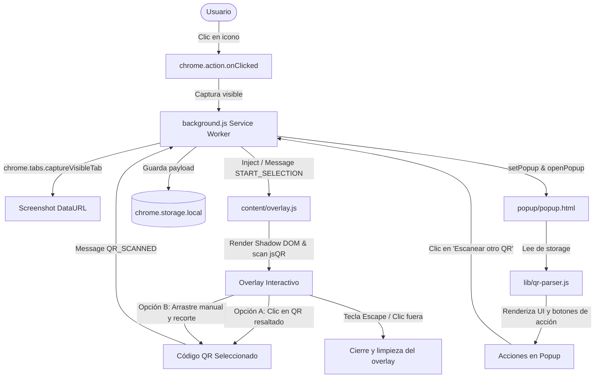

# Especificación de Diseño: Extensión Chrome QR Code Reader

**Fecha:** 2026-11-23  
**Estado:** Propuesta aprobada por el usuario  
**Repositorio:** `git@github.com:yabbadabbadev/qr-reader.chrome-extension.git`

---

## 1. Resumen y Objetivos

Desarrollar una extensión de Google Chrome basada en **Manifest V3** que permita al usuario escanear códigos QR directamente en la pantalla de su navegador.

### Requisitos Principales:
1. **Activación directa:** Al pulsar el icono de la extensión en la barra de herramientas, se activa el modo de selección en la pestaña actual.
2. **Detección dual:**
   - **Automática:** Identifica todos los códigos QR visibles en la pantalla y los resalta con un marco interactivo clicable.
   - **Manual:** Permite al usuario arrastrar el ratón para recortar cualquier área específica de la pantalla.
3. **Apertura de Popup con Acciones Inteligentes:** Al seleccionar un código (automática o manualmente), se abre automáticamente el `popup.html` de la extensión mostrando el contenido analizado y ofreciendo acciones según su tipo:
   - **URL:** Botón para abrir en pestaña nueva y botón para copiar.
   - **Texto:** Botón para copiar al portapapeles.
   - **Wi-Fi:** Visualización de SSID, tipo de seguridad y botón para copiar contraseña.
   - **Email:** Botón para redactar correo (`mailto:`) y copiar dirección.
   - **Teléfono:** Botón para llamar (`tel:`) y copiar número.
4. **Instalación y Verificación:** Instalación de la extensión en modo desarrollador en Chrome y suite de pruebas autónoma con una página de prueba local.

---

## 2. Arquitectura del Sistema (Manifest V3)



---

## 3. Especificación de Componentes

### 3.1. `manifest.json`
- `manifest_version`: 3
- `name`: "QR Code Reader & Scanner"
- `version`: "1.0.0"
- `description`: "Escanea códigos QR en pantalla de forma automática o mediante selección manual."
- `permissions`:
  - `"activeTab"`: Para capturar la pantalla de la pestaña activa tras el gesto del usuario.
  - `"storage"`: Para persistir los datos del QR escaneado entre el content script, service worker y popup.
- `action`:
  - `default_icon`: 16, 48, 128 px.
  - **Sin `default_popup` inicial**: Permite capturar el evento `chrome.action.onClicked`.
- `background`:
  - `"service_worker": "background.js"`
- `icons`:
  - Archivos reales en `icons/icon-16.png` (16×16), `icons/icon-48.png` (48×48) e `icons/icon-128.png` (128×128).

### 3.2. Service Worker (`background.js`)
- Gestiona el ciclo de vida y la comunicación entre la barra de herramientas, la página web y el popup:
  1. **`chrome.action.onClicked`**:
     - Captura la pestaña visible mediante `chrome.tabs.captureVisibleTab(tab.windowId, { format: 'png' })`.
     - Inyecta los scripts y estilos necesarios (`lib/jsqr.js`, `content/overlay.css`, `content/overlay.js`).
     - Envía el mensaje `{ action: "START_SELECTION", screenshot: dataUrl, dpr: tab.devicePixelRatio }`.
  2. **Recepción de mensaje `QR_SCANNED`**:
     - Almacena el resultado en `chrome.storage.local`:
       ```json
       {
         "lastScannedQR": {
           "rawText": "...",
           "scannedAt": 1732389600000
         }
       }
       ```
     - Configura el popup activo: `chrome.action.setPopup({ popup: "popup/popup.html" })`.
     - Invoca `chrome.action.openPopup()` para abrir inmediatamente la ventana de la extensión.
  3. **Recepción de mensaje `RESTART_SCAN`**:
     - Restablece `chrome.action.setPopup({ popup: "" })`.
     - Dispara de nuevo el ciclo de captura sobre la pestaña activa.

### 3.3. Content Script & Overlay (`content/overlay.js` y `content/overlay.css`)
- **Aislamiento Shadow DOM:** El contenedor del overlay (`<div id="qr-reader-root">`) adjunta un `shadowRoot` abierto para encapsular completamente los estilos y evitar colisiones con el CSS de la página anfitriona.
- **Detección Automática:**
  - Crea un `<canvas>` fuera de pantalla con la imagen de la captura.
  - Ejecuta `jsQR` (aprovechando `BarcodeDetector` si está soportado nativamente).
  - Por cada código detectado, calcula su posición en píxeles CSS (`coordenada / window.devicePixelRatio`) y coloca un marcador visible con borde luminoso y etiqueta.
  - Al hacer clic en un marcador, emite el resultado.
- **Selección Manual (Marquee Crop):**
  - Eventos de ratón (`mousedown`, `mousemove`, `mouseup`).
  - Muestra un recuadro de selección semitransparente con borde discontinuo.
  - Al soltar (`mouseup`), recorta la porción de píxeles correspondiente en el canvas auxiliar y la pasa por el motor `jsQR`.
  - Si no encuentra un QR, muestra una notificación emergente ("toast") sutil en la pantalla invitando a reintentar o reajustar el área.
- **Teclado:** Escucha la tecla `Escape` para cerrar el overlay y restaurar la página.

### 3.4. Motor de Decodificación (`lib/jsqr.js`)
- Biblioteca pura en JavaScript empaquetada localmente en la extensión (sin llamadas de red externas, compatible con la CSP de Manifest V3).
- Soporta lectura de imágenes en formato `ImageData` extraídas directamente de un canvas.

### 3.5. Analizador de Formatos (`lib/qr-parser.js`)
Función pura que analiza el string del QR y devuelve un objeto tipado:
- **`URL`**: Expresión regular para protocolos `https?://` o dominios comunes.
- **`WIFI`**: Formato estándar `WIFI:T:WPA;S:MySSID;P:MyPassword;;`. Extrae SSID, contraseña y autenticación.
- **`EMAIL`**: Protocolo `mailto:...` o esquema `MATMSG:TO:...;SUB:...;BODY:...;;`.
- **`TEL`**: Prefijo `tel:...`.
- **`TEXT`**: Texto sin formato específico.

### 3.6. Popup UI (`popup/popup.html`, `popup/popup.js`, `popup/popup.css`)
- **Diseño:**
  - Ancho fijo de 360px, altura dinámica.
  - Modo oscuro/claro automático mediante variables CSS y `@media (prefers-color-scheme: dark)`.
  - Badge de categoría (`URL`, `Texto`, `Wi-Fi`, `Email`, `Teléfono`).
- **Comportamiento dinámico:**
  - Al cargar (`DOMContentLoaded`), consulta `chrome.storage.local` por `lastScannedQR`.
  - Si existe, lo procesa con `qr-parser.js` y renderiza la tarjeta correspondiente con botones de acción.
  - Botón "Copiar": Copia al portapapeles usando `navigator.clipboard.writeText()` y muestra un estado temporal de confirmación ("¡Copiado!").
  - Botón "Abrir enlace": Invoca `chrome.tabs.create({ url })`.
  - Botón "Escanear otro QR": Envía `RESTART_SCAN` al background y llama a `window.close()`.

---

## 4. Plan de Pruebas y Verificación

### 4.1. Página de Pruebas (`test/index.html`)
Se construirá una página web estática con diversos códigos QR generados y visibles:
1. QR con URL a GitHub.
2. QR con un texto largo con formato.
3. QR de conexión Wi-Fi (`WIFI:S:TestNet;T:WPA;P:SecretPass123;;`).
4. QR con enlace telefónico (`tel:+34912345678`).
5. Sección con imágenes pequeñas o fondos para verificar el recorte manual.

### 4.2. Verificación Automatizada con Chrome
1. Iniciar Chrome con la extensión cargada (`--load-extension`).
2. Abrir la página `test/index.html`.
3. Probar la activación del modo selección.
4. Validar la detección automática y el clic sobre un QR resaltado.
5. Validar la selección manual arrastrando el ratón sobre un área.
6. Verificar que el popup se abre y muestra las opciones esperadas según el tipo de QR.

---

## 5. Manejo de Errores y Casos Límite

| Caso Límite | Comportamiento Esperado |
|---|---|
| Pantallas Retina / High-DPI (`devicePixelRatio > 1`) | Las coordenadas del overlay y el canvas se escalan automáticamente por el DPR para evitar desalineaciones en la captura o recorte. |
| Recorte manual sin QR | Notificación toast indicando que no se ha detectado ningún código, manteniendo el overlay activo para otro intento. |
| Páginas con CSP estricta o iframes | El overlay se inserta directamente en el documento principal y la captura se procesa en el contexto de la extensión, inmune a restricciones de la página. |
| Cancelación por usuario | La tecla `Escape` o el botón de cierre eliminan el overlay y dejan la pestaña en su estado original. |
